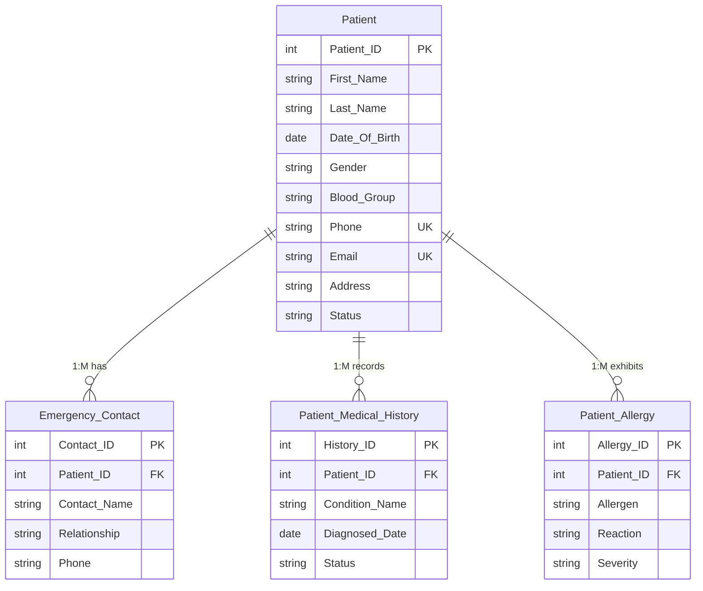
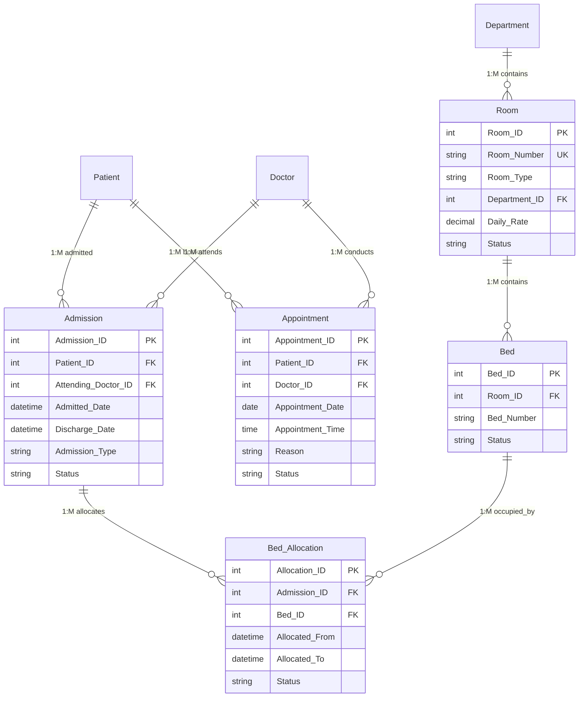
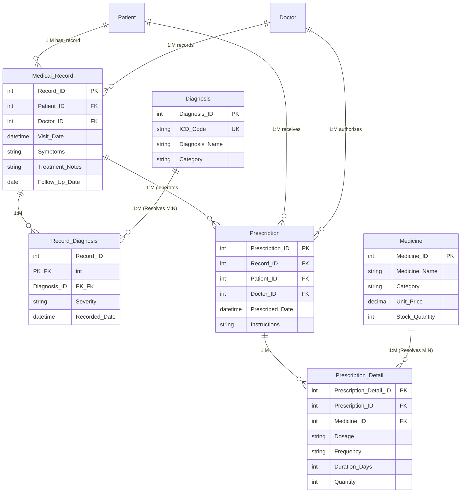
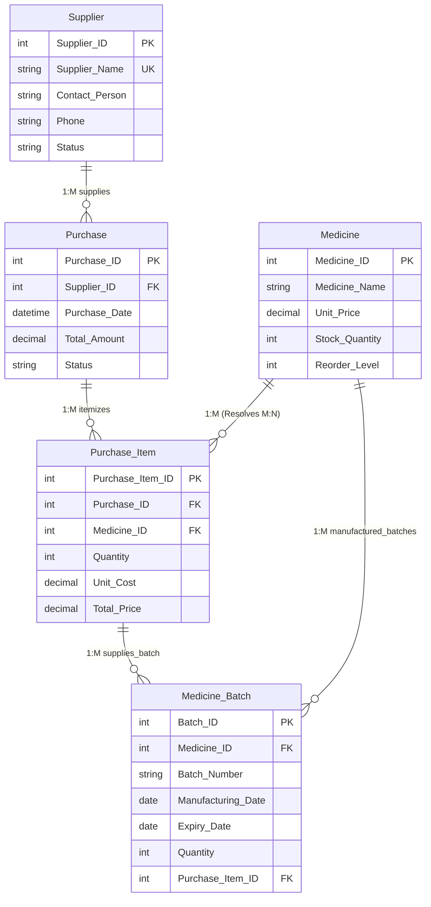
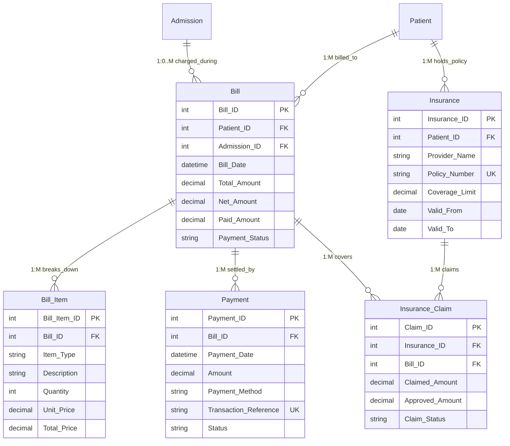
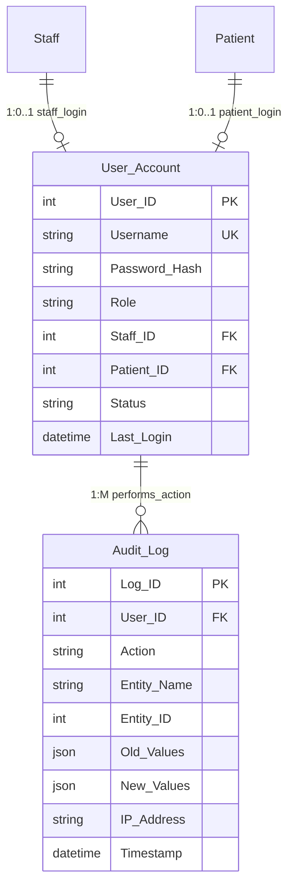

# MediTrack Hospital Management System
## Entity-Relationship (ER) Diagram & Relational Schema Specification
### Advanced DBMS PBL Individual Project — 34 Entities & 45 Referential Integrity Constraints

---

## 1. Executive Summary

This document presents the complete architectural specification and **Entity-Relationship (ER) Diagrams** for the **MediTrack Hospital Management System**, designed and implemented in MySQL 8.0 (InnoDB engine, `utf8mb4` character set).

- **Total Entities / Tables**: **34** (No tables skipped, merged, or renamed)
- **Total Foreign-Key Relationships**: **45**
- **Relational Integrity Engine**: MySQL InnoDB with `ON DELETE CASCADE / RESTRICT / SET NULL`
- **Database Engine Standards**: Boyce-Codd Normal Form (BCNF) / Third Normal Form (3NF)

---

## 2. Global Master ER Diagram (All 34 Entities)

The following diagram connects all 34 relational entities across all 8 modules of the hospital system:

```mermaid
erDiagram
    %% ==========================================
    %% MODULE B: DEPARTMENTS & STAFF
    %% ==========================================
    Department ||--o{ Staff : employs
    Department ||--o{ Room : houses
    Staff ||--o| Department : manages_as_head
    Staff ||--|| Doctor : specializes_as
    Staff ||--|| Nurse : specializes_as
    Doctor ||--o{ Doctor_Schedule : has_duty

    %% ==========================================
    %% MODULE A: PATIENT MANAGEMENT
    %% ==========================================
    Patient ||--o{ Emergency_Contact : has_contact
    Patient ||--o{ Patient_Medical_History : has_history
    Patient ||--o{ Patient_Allergy : has_allergy

    %% ==========================================
    %% MODULE C: ROOMS, BEDS & ADMISSIONS
    %% ==========================================
    Room ||--o{ Bed : contains
    Patient ||--o{ Appointment : schedules
    Doctor ||--o{ Appointment : attends
    Patient ||--o{ Admission : admitted_as
    Doctor ||--o{ Admission : admits_and_attends
    Admission ||--o{ Bed_Allocation : assigns
    Bed ||--o{ Bed_Allocation : allocated_in

    %% ==========================================
    %% MODULE D: CLINICAL ENCOUNTERS & RX
    %% ==========================================
    Patient ||--o{ Medical_Record : owns
    Doctor ||--o{ Medical_Record : writes
    Medical_Record ||--o{ Record_Diagnosis : includes
    Diagnosis ||--o{ Record_Diagnosis : applied_in
    Medical_Record ||--o{ Prescription : generates
    Patient ||--o{ Prescription : prescribed_for
    Doctor ||--o{ Prescription : authorizes
    Prescription ||--o{ Prescription_Detail : contains
    Medicine ||--o{ Prescription_Detail : dispenses

    %% ==========================================
    %% MODULE E: LABORATORY SERVICES
    %% ==========================================
    Patient ||--o{ Lab_Order : orders_for
    Doctor ||--o{ Lab_Order : prescribes_test
    Lab_Test ||--o{ Lab_Order : specifies
    Lab_Order ||--|| Lab_Report : results_in
    Staff ||--o{ Lab_Report : conducted_by

    %% ==========================================
    %% MODULE F: PHARMACY & INVENTORY
    %% ==========================================
    Supplier ||--o{ Purchase : supplies
    Purchase ||--o{ Purchase_Item : itemizes
    Medicine ||--o{ Purchase_Item : purchased
    Medicine ||--o{ Medicine_Batch : tracked_as
    Purchase_Item ||--o{ Medicine_Batch : stocks

    %% ==========================================
    %% MODULE G: BILLING & INSURANCE
    %% ==========================================
    Patient ||--o{ Bill : billed_to
    Admission ||--o{ Bill : incurred_during
    Bill ||--o{ Bill_Item : breaks_down
    Bill ||--o{ Payment : paid_via
    Patient ||--o{ Insurance : holds_policy
    Insurance ||--o{ Insurance_Claim : claims_from
    Bill ||--o{ Insurance_Claim : claimed_against

    %% ==========================================
    %% MODULE H: SECURITY & AUDITING
    %% ==========================================
    Staff ||--o| User_Account : credentials_for
    Patient ||--o| User_Account : portal_access
    User_Account ||--o{ Audit_Log : initiates

    %% ==========================================
    %% ENTITY DEFINITIONS & KEY ATTRIBUTES
    %% ==========================================
    Department {
        int Department_ID PK
        string Department_Name UK
        int Head_Of_Department FK
        string Location
        string Contact_Number
    }

    Staff {
        int Staff_ID PK
        string First_Name
        string Last_Name
        string Email UK
        string Phone UK
        string Role
        int Department_ID FK
        date Date_Of_Joining
        decimal Salary
    }

    Doctor {
        int Doctor_ID PK_FK
        string Specialization
        string Qualification
        string License_Number UK
        decimal Consultation_Fee
        string Room_Number
    }

    Nurse {
        int Nurse_ID PK_FK
        string Qualification
        string License_Number UK
        string Shift
        string Assigned_Ward
    }

    Doctor_Schedule {
        int Schedule_ID PK
        int Doctor_ID FK
        string Day_Of_Week
        time Start_Time
        time End_Time
        int Max_Appointments
    }

    Patient {
        int Patient_ID PK
        string First_Name
        string Last_Name
        date Date_Of_Birth
        string Gender
        string Blood_Group
        string Phone UK
        string Email UK
        string Address
    }

    Emergency_Contact {
        int Contact_ID PK
        int Patient_ID FK
        string Contact_Name
        string Relationship
        string Phone
    }

    Patient_Medical_History {
        int History_ID PK
        int Patient_ID FK
        string Condition_Name
        date Diagnosed_Date
        string Status
    }

    Patient_Allergy {
        int Allergy_ID PK
        int Patient_ID FK
        string Allergen
        string Reaction
        string Severity
    }

    Room {
        int Room_ID PK
        string Room_Number UK
        string Room_Type
        int Department_ID FK
        decimal Daily_Rate
        string Status
    }

    Bed {
        int Bed_ID PK
        int Room_ID FK
        string Bed_Number
        string Status
    }

    Appointment {
        int Appointment_ID PK
        int Patient_ID FK
        int Doctor_ID FK
        date Appointment_Date
        time Appointment_Time
        string Reason
        string Status
    }

    Admission {
        int Admission_ID PK
        int Patient_ID FK
        int Attending_Doctor_ID FK
        datetime Admitted_Date
        datetime Discharge_Date
        string Admission_Type
        string Status
    }

    Bed_Allocation {
        int Allocation_ID PK
        int Admission_ID FK
        int Bed_ID FK
        datetime Allocated_From
        datetime Allocated_To
        string Status
    }

    Medical_Record {
        int Record_ID PK
        int Patient_ID FK
        int Doctor_ID FK
        datetime Visit_Date
        string Symptoms
        string Treatment_Notes
    }

    Diagnosis {
        int Diagnosis_ID PK
        string ICD_Code UK
        string Diagnosis_Name
        string Category
    }

    Record_Diagnosis {
        int Record_ID PK_FK
        int Diagnosis_ID PK_FK
        string Severity
        datetime Recorded_Date
    }

    Prescription {
        int Prescription_ID PK
        int Record_ID FK
        int Patient_ID FK
        int Doctor_ID FK
        datetime Prescribed_Date
    }

    Prescription_Detail {
        int Prescription_Detail_ID PK
        int Prescription_ID FK
        int Medicine_ID FK
        string Dosage
        string Frequency
        int Duration_Days
        int Quantity
    }

    Medicine {
        int Medicine_ID PK
        string Medicine_Name
        string Generic_Name
        string Category
        decimal Unit_Price
        int Stock_Quantity
        int Reorder_Level
    }

    Supplier {
        int Supplier_ID PK
        string Supplier_Name UK
        string Contact_Person
        string Phone
        string Email
    }

    Purchase {
        int Purchase_ID PK
        int Supplier_ID FK
        datetime Purchase_Date
        decimal Total_Amount
        string Status
    }

    Purchase_Item {
        int Purchase_Item_ID PK
        int Purchase_ID FK
        int Medicine_ID FK
        int Quantity
        decimal Unit_Cost
        decimal Total_Price
    }

    Medicine_Batch {
        int Batch_ID PK
        int Medicine_ID FK
        string Batch_Number
        date Manufacturing_Date
        date Expiry_Date
        int Quantity
        int Purchase_Item_ID FK
    }

    Lab_Test {
        int Test_ID PK
        string Test_Name UK
        string Category
        decimal Cost
        string Normal_Range
    }

    Lab_Order {
        int Order_ID PK
        int Patient_ID FK
        int Doctor_ID FK
        int Test_ID FK
        datetime Order_Date
        string Priority
        string Status
    }

    Lab_Report {
        int Report_ID PK
        int Order_ID UK_FK
        int Conducted_By FK
        string Result_Value
        datetime Report_Date
        string Status
    }

    Bill {
        int Bill_ID PK
        int Patient_ID FK
        int Admission_ID FK
        datetime Bill_Date
        decimal Total_Amount
        decimal Net_Amount
        decimal Paid_Amount
        string Payment_Status
    }

    Bill_Item {
        int Bill_Item_ID PK
        int Bill_ID FK
        string Item_Type
        string Description
        int Quantity
        decimal Unit_Price
        decimal Total_Price
    }

    Payment {
        int Payment_ID PK
        int Bill_ID FK
        datetime Payment_Date
        decimal Amount
        string Payment_Method
        string Transaction_Reference UK
    }

    Insurance {
        int Insurance_ID PK
        int Patient_ID FK
        string Provider_Name
        string Policy_Number UK
        decimal Coverage_Limit
        date Valid_From
        date Valid_To
    }

    Insurance_Claim {
        int Claim_ID PK
        int Insurance_ID FK
        int Bill_ID FK
        datetime Claim_Date
        decimal Claimed_Amount
        decimal Approved_Amount
        string Claim_Status
    }

    User_Account {
        int User_ID PK
        string Username UK
        string Password_Hash
        string Role
        int Staff_ID FK
        int Patient_ID FK
        string Status
    }

    Audit_Log {
        int Log_ID PK
        int User_ID FK
        string Action
        string Entity_Name
        int Entity_ID
        string IP_Address
        datetime Timestamp
    }
```

---

## 3. Modular Sub-ER Diagrams (Examiner & Viva Ready)

### Module A: Patient Management (Tables 1 – 4)
Handles patient identification, primary emergency contacts, chronic disease history, and drug/environmental allergies.



---

### Module B: Doctor and Staff Management (Tables 5 – 9)
Implements table inheritance / specialization where `Doctor` and `Nurse` are subtypes of the `Staff` supertype entity.

```mermaid
erDiagram
    Department ||--o{ Staff : "1:M employs"
    Staff ||--o| Department : "1:0..1 heads"
    Staff ||--|| Doctor : "1:1 specializes_as"
    Staff ||--|| Nurse : "1:1 specializes_as"
    Doctor ||--o{ Doctor_Schedule : "1:M weekly_roster"

    Department {
        int Department_ID PK
        string Department_Name UK
        int Head_Of_Department FK
        string Location
        string Contact_Number
    }

    Staff {
        int Staff_ID PK
        string First_Name
        string Last_Name
        string Email UK
        string Phone UK
        string Role
        int Department_ID FK
        decimal Salary
    }

    Doctor {
        int Doctor_ID PK_FK "References Staff(Staff_ID)"
        string Specialization
        string Qualification
        string License_Number UK
        decimal Consultation_Fee
        string Room_Number
    }

    Nurse {
        int Nurse_ID PK_FK "References Staff(Staff_ID)"
        string Qualification
        string License_Number UK
        string Shift
        string Assigned_Ward
    }

    Doctor_Schedule {
        int Schedule_ID PK
        int Doctor_ID FK
        string Day_Of_Week
        time Start_Time
        time End_Time
        int Max_Appointments
    }
```

---

### Module C: Appointment, Rooms and Inpatient Admissions (Tables 10 – 14)
Manages hospital beds, wards, patient appointments, and inpatient bed occupancy tracking.



---

### Module D: Medical Records, Diagnoses & Prescriptions (Tables 15 – 19)
Resolves Many-to-Many ($M:N$) relationships using composite associative entities `Record_Diagnosis` and `Prescription_Detail`.



---

### Module E: Laboratory Management (Tables 20 – 22)
Handles diagnostic investigations with a 1:1 relationship between orders and finalized pathology reports.

```mermaid
erDiagram
    Patient ||--o{ Lab_Order : "1:M requested_for"
    Doctor ||--o{ Lab_Order : "1:M ordered_by"
    Lab_Test ||--o{ Lab_Order : "1:M test_type"
    Lab_Order ||--|| Lab_Report : "1:1 finalized_as"
    Staff ||--o{ Lab_Report : "1:M conducted_by"

    Lab_Test {
        int Test_ID PK
        string Test_Name UK
        string Category
        decimal Cost
        string Normal_Range
    }

    Lab_Order {
        int Order_ID PK
        int Patient_ID FK
        int Doctor_ID FK
        int Test_ID FK
        datetime Order_Date
        string Priority
        string Status
    }

    Lab_Report {
        int Report_ID PK
        int Order_ID UK_FK
        int Conducted_By FK
        string Result_Value
        datetime Report_Date
        string Status
    }
```

---

### Module F: Pharmacy & Medicine Inventory (Tables 23 – 27)
Resolves $M:N$ purchase-to-medicine relationships and tracks drug batch safety and expiration dates.



---

### Module G: Patient Billing & Health Insurance (Tables 28 – 32)
Handles patient invoicing, itemized medical billing, payment transactions (UPI, Cash, Card, Insurance), and insurance cashless claim settlements.



---

### Module H: Security, RBAC & Immutable Audit Logs (Tables 33 – 34)
Maintains system accounts linked to employees or patients, supporting Role-Based Access Control and recording audit trails with JSON snapshots.



---

## 4. Referential Integrity Matrix (All 45 Foreign Keys)

| # | Child Entity (Table) | Foreign Key Column | Parent Entity (Referenced Table) | Referenced Column | Cardinality | ON DELETE Rule | Purpose / Meaning |
|---|----------------------|--------------------|----------------------------------|-------------------|-------------|----------------|-------------------|
| 1 | `Department` | `Head_Of_Department` | `Staff` | `Staff_ID` | $1:0..1$ | `SET NULL` | Department chairperson / head doctor |
| 2 | `Staff` | `Department_ID` | `Department` | `Department_ID` | $1:M$ | `RESTRICT` | Employee departmental assignment |
| 3 | `Doctor` | `Doctor_ID` | `Staff` | `Staff_ID` | $1:1$ | `CASCADE` | Subtype specialization of Staff |
| 4 | `Nurse` | `Nurse_ID` | `Staff` | `Staff_ID` | $1:1$ | `CASCADE` | Subtype specialization of Staff |
| 5 | `Doctor_Schedule` | `Doctor_ID` | `Doctor` | `Doctor_ID` | $1:M$ | `CASCADE` | Weekly OPD consultation timings |
| 6 | `Emergency_Contact` | `Patient_ID` | `Patient` | `Patient_ID` | $1:M$ | `CASCADE` | Primary emergency contact person |
| 7 | `Patient_Medical_History` | `Patient_ID` | `Patient` | `Patient_ID` | $1:M$ | `CASCADE` | Pre-existing medical conditions |
| 8 | `Patient_Allergy` | `Patient_ID` | `Patient` | `Patient_ID` | $1:M$ | `CASCADE` | Known drug and food allergies |
| 9 | `Room` | `Department_ID` | `Department` | `Department_ID` | $1:M$ | `RESTRICT` | Ward/Room department location |
| 10 | `Bed` | `Room_ID` | `Room` | `Room_ID` | $1:M$ | `CASCADE` | Bed belonging to room |
| 11 | `Appointment` | `Patient_ID` | `Patient` | `Patient_ID` | $1:M$ | `RESTRICT` | Patient booking the consultation |
| 12 | `Appointment` | `Doctor_ID` | `Doctor` | `Doctor_ID` | $1:M$ | `RESTRICT` | Specialist doctor conducting OPD |
| 13 | `Admission` | `Patient_ID` | `Patient` | `Patient_ID` | $1:M$ | `RESTRICT` | Inpatient admitted to hospital |
| 14 | `Admission` | `Attending_Doctor_ID` | `Doctor` | `Doctor_ID` | $1:M$ | `RESTRICT` | Attending physician for admission |
| 15 | `Bed_Allocation` | `Admission_ID` | `Admission` | `Admission_ID` | $1:M$ | `RESTRICT` | Admission session for bed |
| 16 | `Bed_Allocation` | `Bed_ID` | `Bed` | `Bed_ID` | $1:M$ | `RESTRICT` | Specific bed assigned to patient |
| 17 | `Medical_Record` | `Patient_ID` | `Patient` | `Patient_ID` | $1:M$ | `RESTRICT` | Patient examined in consultation |
| 18 | `Medical_Record` | `Doctor_ID` | `Doctor` | `Doctor_ID` | $1:M$ | `RESTRICT` | Consulting physician documenting note |
| 19 | `Record_Diagnosis` | `Record_ID` | `Medical_Record` | `Record_ID` | $1:M$ | `CASCADE` | Encounter linking to diagnosis ($M:N$) |
| 20 | `Record_Diagnosis` | `Diagnosis_ID` | `Diagnosis` | `Diagnosis_ID` | $1:M$ | `RESTRICT` | ICD-10 diagnosis applied to record |
| 21 | `Prescription` | `Record_ID` | `Medical_Record` | `Record_ID` | $1:M$ | `CASCADE` | Encounter generating the prescription |
| 22 | `Prescription` | `Patient_ID` | `Patient` | `Patient_ID` | $1:M$ | `RESTRICT` | Patient receiving medication |
| 23 | `Prescription` | `Doctor_ID` | `Doctor` | `Doctor_ID` | $1:M$ | `RESTRICT` | Physician authorizing prescription |
| 24 | `Prescription_Detail` | `Prescription_ID` | `Prescription` | `Prescription_ID` | $1:M$ | `CASCADE` | Prescription line item ($M:N$) |
| 25 | `Prescription_Detail` | `Medicine_ID` | `Medicine` | `Medicine_ID` | $1:M$ | `RESTRICT` | Medicine formulation dispensed |
| 26 | `Lab_Order` | `Patient_ID` | `Patient` | `Patient_ID` | $1:M$ | `RESTRICT` | Patient undergoing lab tests |
| 27 | `Lab_Order` | `Doctor_ID` | `Doctor` | `Doctor_ID` | $1:M$ | `RESTRICT` | Referring physician for lab order |
| 28 | `Lab_Order` | `Test_ID` | `Lab_Test` | `Test_ID` | $1:M$ | `RESTRICT` | Diagnostic test ordered |
| 29 | `Lab_Report` | `Order_ID` | `Lab_Order` | `Order_ID` | $1:1$ | `CASCADE` | Unique report for lab order |
| 30 | `Lab_Report` | `Conducted_By` | `Staff` | `Staff_ID` | $1:M$ | `RESTRICT` | Lab technician performing test |
| 31 | `Purchase` | `Supplier_ID` | `Supplier` | `Supplier_ID` | $1:M$ | `RESTRICT` | Pharmaceutical vendor/supplier |
| 32 | `Purchase_Item` | `Purchase_ID` | `Purchase` | `Purchase_ID` | $1:M$ | `CASCADE` | Purchase invoice order item ($M:N$) |
| 33 | `Purchase_Item` | `Medicine_ID` | `Medicine` | `Medicine_ID` | $1:M$ | `RESTRICT` | Drug product restocked |
| 34 | `Medicine_Batch` | `Medicine_ID` | `Medicine` | `Medicine_ID` | $1:M$ | `CASCADE` | Manufactured batch for medicine |
| 35 | `Medicine_Batch` | `Purchase_Item_ID` | `Purchase_Item` | `Purchase_Item_ID` | $1:0..M$ | `SET NULL` | Originating purchase line item |
| 36 | `Bill` | `Patient_ID` | `Patient` | `Patient_ID` | $1:M$ | `RESTRICT` | Patient responsible for bill |
| 37 | `Bill` | `Admission_ID` | `Admission` | `Admission_ID` | $1:0..M$ | `SET NULL` | Inpatient stay linked to invoice |
| 38 | `Bill_Item` | `Bill_ID` | `Bill` | `Bill_ID` | $1:M$ | `CASCADE` | Itemized charges on hospital bill |
| 39 | `Payment` | `Bill_ID` | `Bill` | `Bill_ID` | $1:M$ | `RESTRICT` | Invoice settled by payment |
| 40 | `Insurance` | `Patient_ID` | `Patient` | `Patient_ID` | $1:M$ | `RESTRICT` | Patient holding insurance policy |
| 41 | `Insurance_Claim` | `Insurance_ID` | `Insurance` | `Insurance_ID` | $1:M$ | `RESTRICT` | Policy covering the hospital claim |
| 42 | `Insurance_Claim` | `Bill_ID` | `Bill` | `Bill_ID` | $1:M$ | `RESTRICT` | Hospital bill claimed for settlement |
| 43 | `User_Account` | `Staff_ID` | `Staff` | `Staff_ID` | $1:0..1$ | `SET NULL` | Employee linked to login account |
| 44 | `User_Account` | `Patient_ID` | `Patient` | `Patient_ID` | $1:0..1$ | `SET NULL` | Patient linked to portal account |
| 45 | `Audit_Log` | `User_ID` | `User_Account` | `User_ID` | $1:M$ | `SET NULL` | User performing database action |

---

## 5. DBMS Normalization Analysis (3NF & BCNF)

1. **First Normal Form (1NF)**:
   - All table attributes are atomic. There are no repeating groups or multi-valued columns.
   - Multi-valued emergency contacts, medical histories, and allergies are normalized into dedicated 1:M tables (`Emergency_Contact`, `Patient_Medical_History`, `Patient_Allergy`).
2. **Second Normal Form (2NF)**:
   - All tables possess a defined primary key.
   - In composite junction tables (`Record_Diagnosis`, `uk_room_bed`), every non-key attribute is fully functionally dependent on the entire composite primary key, eliminating partial dependencies.
3. **Third Normal Form (3NF)**:
   - There are no transitive dependencies ($X \to Y \to Z$).
   - Doctor consultation fees, room daily rates, and medicine unit prices are stored in their master tables rather than repeated in transactional tables.
4. **Boyce-Codd Normal Form (BCNF)**:
   - For every functional dependency $X \to Y$, $X$ is a superkey.
   - Inheritance/specialization hierarchies (`Staff` $\to$ `Doctor`, `Staff` $\to$ `Nurse`) maintain determinant consistency without null-bloat.
